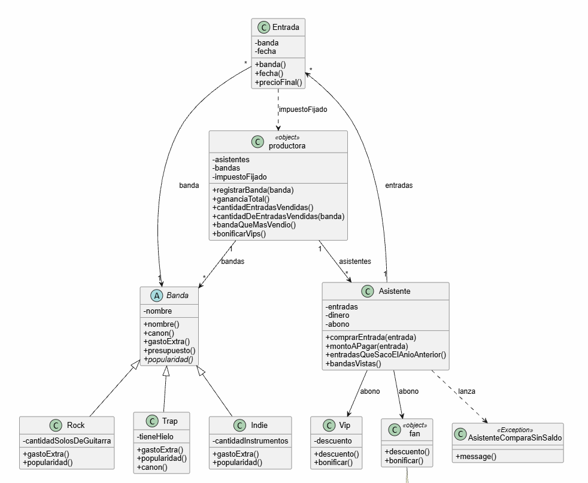

# justificar las decisiones 

1) En el abono use composicion sobre herencia ya que aunque el texto no lo dice, Ro nos dijo que podia cambiar el abono de fan a vip y viceversa, y para lograr este cambio es necesario usar composicion.

2) Utlice herencia para no repetir logica en la parte que hablamos sobre las bandas y empezamos a diferenciarlas unas a otras por si son de rock, indie, etc. 

3) Tambien utilice el concepto de polimorfismo en el tp, concretamenta en la distincion de vip y fan, donde los dos entienden los mismo dos metodos y hacen cosas distintas, Lo mismo pasa con las bandas: presupuesto() llama a gastoExtra() y cada tipo de banda lo resuelve a su manera.

4) En ocaciones utilize const property y el nombre de una variable para inicializarla y de esta forma tener el getter de la varibale sin crear el setter, haciendo de esta forma mas seguro el codigo. (encapsulamiento)

5) A la productora la cree como un objeto y no como una clase ya que habla el texto todo el tiempo de que hay una unica productora.

6) realice excepciones para cuando el cliente no tiene el saldo positivo y por ende no puede comprar una nueva entrada. Aca hay una aclaracion yo hice que aunque no le alcance la plata pueda comprar la entrada y quedara con saldo negativo, esto porque sino nunca podria quedar con un saldo negativo y el texto te aclara que es una posibilidad. Ademas que como no dice nada no quise complejizar el codigo.

# Diagrama de clases
